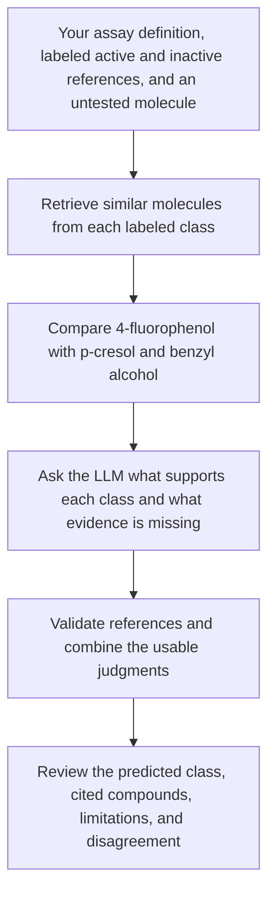

# MolActAgent

**An open-source AI agent for molecular activity and the evidence behind each prediction.**

You have an untested molecule and reference compounds from the same assay. MolActAgent finds similar examples from the active and inactive groups, asks a language model to compare their structures and properties, and combines the valid judgments. The HTML report lets you inspect the compounds behind each cited comparison, see where judgments disagree, and decide what to follow up experimentally.

[Project website](https://studentiz.github.io/MolActAgent/) · [Open the example report](https://studentiz.github.io/MolActAgent/molecular-example.html) · [Tutorial](docs/tutorial.md#predict-from-smiles) · [Changelog](CHANGELOG.md)

## Follow one prediction

The teaching assay defines an active molecule by a hydroxyl attached directly to an aromatic ring. 4-Fluorophenol has that linkage, like the active reference p-cresol. The inactive reference benzyl alcohol also has a hydroxyl, separated from the ring by one carbon. The report highlights the attachment bond and shows the missing comparison for the para-fluoro substitution. The example uses synthetic labels to demonstrate the workflow.



Give the agent a reference CSV with `smiles,label`, a query CSV with `smiles`, and the definition of the assay and class labels. An optional `id` or `name` column connects the report to your lab records. You can also include reference pChEMBL measurements from the assay. Each prediction carries a class or `Inconclusive`, the evidence behind it, and enough run information to inspect the result. [Prepare your own data](docs/tutorial.md#use-your-own-data)

## Reproduce the report offline

Use Python 3.12 for the teaching example. The tagged code, pinned dependencies, two CSVs, and saved responses reproduce the decision without an API key.

```bash
git clone --branch v0.5.0 https://github.com/studentiz/MolActAgent.git
cd MolActAgent
python3.12 -m venv .venv
source .venv/bin/activate
python -m pip install -e ".[chem]" -c examples/molecular/constraints.txt

molactagent molecular \
  --reference examples/molecular/reference.csv \
  --test examples/molecular/query.csv \
  --replay examples/molecular/responses.json \
  --output-dir molecular-output
```

The output lists `Q1` as `active`. Open `molecular-output/report.html` and select a cited compound to see its reference record. Windows commands and the next steps for a live model are in the tutorial. [Installation and replay guide](docs/tutorial.md#predict-from-smiles)

## Use your own data

Configure an OpenAI-compatible Chat Completions service and run your two tables with `molactagent molecular` or `molactagent.molecular.MolecularClassifier`. Save a live run with `--record` to reproduce its decisions offline. The service can return different judgments on a new live run. The report shows the number of usable judgments alongside the label, and the model score has no probability calibration. [Live walkthrough](docs/tutorial.md#use-a-live-model) · [How to read the report](docs/reports.md#reports-from-smiles)

## What's new in v0.5.0

- Rebuilt GitHub Pages, the tutorial and the molecular design guide around an end-to-end chemical comparison.
- Reworked the HTML report around the prediction, the supporting structure comparisons and the evidence gaps. Citations link to the exact compounds shown to the LLM.
- Added evidence validation, retained explicit LLM abstentions and required usable class judgments from more than half of the planned main-panel votes. Calls record response validation, truncation and request errors.
- Preserved CSV compound identifiers and checked explicit pChEMBL label rules and contradictory labels for identical structures. Output paths are checked before live requests.
- Added replay recordings with input fingerprints, software versions and effective settings. Use v0.4.1 for schema 1 recordings from that release. Aligned the SMILES CLI and Python default output budget at 16,384 tokens. [Full changelog](CHANGELOG.md)

## Other interfaces and project resources

- `molactagent run` and `MolActAgentClassifier` support classification from numeric feature tables. [Iris tutorial](docs/tutorial.md#iris-tutorial-for-numeric-tables)
- The molecular design notes document reference retrieval, comparison prompts, response checks and decision rules. [Design notes](docs/design.md#molecular-binary-classification)
- Continuous-target regression is experimental. [Regression guide](docs/experimental-regression.md)
- See how to contribute, cite the software, and use it under the MIT license. [Contributing](CONTRIBUTING.md) · [Citation](CITATION.cff) · [License](LICENSE)
