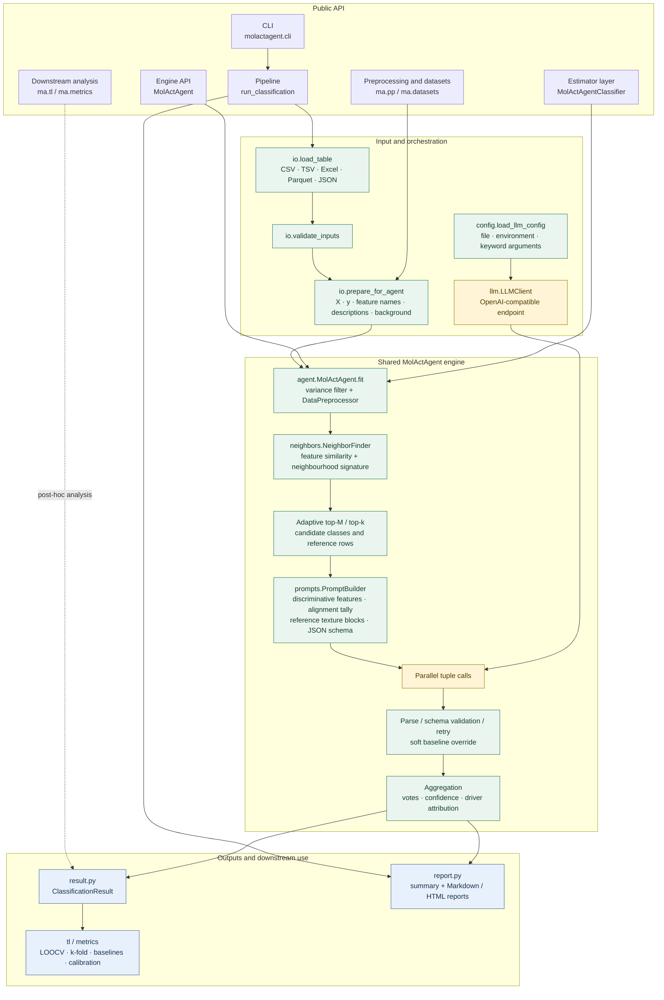

# MolActAgent

Small-data molecular activity prediction with explicit reference comparisons.

[](https://github.com/studentiz/MolActAgent/actions/workflows/tests.yml) [](https://www.python.org/) [](LICENSE)

MolActAgent is a Python package for molecular activity classification from small labelled datasets. The SMILES classifier retrieves nearby active and inactive molecules, asks an OpenAI-compatible model to compare their structures and properties, and aggregates the model judgments into a prediction with an evidence report. The package also supports classification from numeric feature tables.

> MolActAgent is research software. A model-generated explanation is not an independent scientific citation, and the confidence score is not a calibrated probability. Validate results against suitable baselines and domain knowledge before using them in a real study.

## What's New in 0.4.1

- SMILES reports show the recorded chemical rationale, side-by-side molecule structures, counter-evidence and disagreement alongside each prediction.
- Compound names can appear alongside IDs, and focused judgments link to the reference structures used in that comparison.
- The GitHub Pages example and tutorial use the same tagged code and recorded responses. [Full changelog](CHANGELOG.md)

## What's New in 0.4.0

- Added the SMILES binary classifier in the `molactagent molecular` command and the `MolecularClassifier` Python interface.
- Added reference-panel reports with individual model judgments, counter-evidence, and explicit inconclusive outcomes.
- Added a complete teaching example with recorded model responses for offline replay and instructions for live prediction.
- Redesigned the documentation site around the molecular workflow and the runnable example.
- Existing `molactagent run`, `MolActAgentClassifier`, and their tabular inputs remain supported. [Full changelog](CHANGELOG.md)

## Start here

| If you want to... | Read |
| --- | --- |
| Run a SMILES prediction with or without API credentials | [Molecular quick start](docs/tutorial.md#predict-from-smiles) |
| Use the numeric feature-table classifier | [Iris tutorial](docs/tutorial.md#iris-tutorial-for-numeric-tables) |
| Understand the classification engine, result schema, and design decisions | [Design notes](docs/design.md) |
| Explore a full evidence report without an API key | [HTML report guide](docs/reports.md) · [Offline example](examples/evidence_report) |

The tutorial is the practical entry point. The design notes are the technical reference. The rest of this README is a compact orientation to both.

## What is included

| Part | Purpose |
| --- | --- |
| `MolActAgentClassifier` | scikit-learn-style classification with `fit`, `predict`, `predict_proba`, and `score` |
| `run_classification` | File-oriented pipeline that validates inputs and writes summary and interpretability reports |
| `molactagent` CLI | Validation, batch prediction, JSON/CSV/JSONL output, and config-file setup |
| `ma.pp` and `ma.datasets` | Tabular preprocessing, SMILES featurisation, and bundled examples |

The core input is a numeric table. Chemistry helpers can convert SMILES to RDKit descriptors, MACCS keys, Morgan fingerprints, and scaffolds before prediction.

## Architecture

The SMILES classifier retrieves near neighbors from each class using Morgan
fingerprint similarity. It contrasts their structures and properties, collects
LLM judgments, and aggregates valid labels. [Molecular design](docs/design.md#molecular-binary-classification)

### Feature-table engine

The public interfaces are thin layers around one shared prediction engine. Python owns input validation, preprocessing, reference selection, response checks, and aggregation. The language model is used inside the structured comparison stage.



The detailed rationale and call graph are in [docs/design.md](docs/design.md), especially [§11 Module map and data flow](docs/design.md#11-module-map-and-data-flow) and [§18 Aggregation](docs/design.md#18-stage-7--aggregation-calibration-attribution).

## Installation

MolActAgent is currently installed from the source repository.

```bash
git clone https://github.com/studentiz/MolActAgent.git
cd MolActAgent

python -m venv .venv
source .venv/bin/activate       # Windows PowerShell: .venv\Scripts\Activate.ps1

python -m pip install --upgrade pip
python -m pip install -e .
```

For SMILES and RDKit-based examples:

```bash
python -m pip install -e ".[chem]"
```

For a reproducible Conda environment with the optional readers, chemistry tools, baselines, and test dependencies:

```bash
conda env create -f environment.yml
conda activate molactagent_env
python -m pip install -e .
```

Check the installation:

```bash
python -c "import molactagent as ma; print(ma.__version__)"
```

The bundled datasets live in the source checkout, so use an editable install when following the examples below.

## Quick Start With SMILES

From the repository root after installing the chemistry extra, run the
bundled teaching example. It uses recorded responses and requires no API key.

```bash
molactagent molecular \
  --reference examples/molecular/reference.csv \
  --test examples/molecular/query.csv \
  --id-column id \
  --endpoint @examples/molecular/endpoint.txt \
  --replay examples/molecular/responses.json \
  --output-dir molecular-output
```

Open `molecular-output/report.html` to compare structures and read the chemical
rationale and counter-evidence for the prediction. The tutorial covers pinned
dependencies, using your own model and SMILES tables, and reading the results.
[Tutorial](docs/tutorial.md#predict-from-smiles) · [Example report](https://studentiz.github.io/MolActAgent/molecular-example.html)

## Quick Start With Numeric Tables

Set the credentials for an OpenAI-compatible endpoint. Keep the key in your shell environment or a local config file; do not commit it.

```bash
export MOLACTAGENT_API_KEY="your-api-key"
export MOLACTAGENT_BASE_URL="https://api.deepseek.com"
export MOLACTAGENT_MODEL="your-model-name"
```

Then run the bundled iris example:

```python
import molactagent as ma

iris = ma.datasets.load_iris_flowers()

clf = ma.MolActAgentClassifier(k=3, max_workers=4)
clf.fit(iris.X_train, iris.y_train)

labels = clf.predict(iris.X_test)
print(labels)
```

The estimator resolves the three `MOLACTAGENT_*` variables automatically. `X_train` and `y_train` are the labelled reference set; `X_test` contains the rows to predict.

To inspect a complete result instead of only the labels:

```python
result = clf.predict_full(iris.X_test)[0]

print(result.label)
print(result.confidence)
print(result.reference_info)
print(result.driver_attribution)
print(result.vote_summary)
```

`predict_proba` is a normalised weighted-vote distribution. It is useful for comparing the classes considered by the engine, but it should not be read as a statistically calibrated probability without an external calibration study.

## Command-line usage

Create a local JSONC config file and replace its placeholder values:

```bash
molactagent init-config --path llm_config.jsonc
```

Validate the bundled iris inputs without making an LLM call:

```bash
molactagent validate \
  --reference examples/iris_flowers/reference.csv \
  --test examples/iris_flowers/test.csv \
  --label-column species \
  --id-column flower_id
```

Run the classification pipeline:

```bash
molactagent run \
  --reference examples/iris_flowers/reference.csv \
  --test examples/iris_flowers/test.csv \
  --label-column species \
  --id-column flower_id \
  --feature-descriptions examples/iris_flowers/feature_descriptions.json \
  --background @examples/iris_flowers/background.txt \
  --llm-config llm_config.jsonc \
  --output-dir outputs
```

The default run writes `summary.csv`, `interpretability.md`, and `interpretability.html` to `outputs/`. Add `--per-sample` when per-row reports are needed. Use `--format jsonl`, `--format json`, `--format csv`, or `--format tsv` when another program should consume stdout.

## Interactive chemical evidence reports

The HTML evidence viewer keeps the complete decision trace accessible:
supporting and opposing evidence, every saved feature rationale, a
reference-comparison selector, numerical feature tables, weighted class
support and the original prediction JSON. Chemical names and feature
definitions make the recorded comparisons easier to read.

Try the clearly labelled illustrative example without an API key:

```bash
python examples/evidence_report/render.py
```

Open `examples/evidence_report/outputs/evidence_report.html` in a browser.
The example uses synthetic activity labels and handwritten explanations;
it is not an experimental result. Exporting a saved record requires no
additional LLM call.

The viewer is enabled by an optional `report_context` mapping passed in a
classification record to the existing `render_html_report` function.
The CLI's default output keeps its existing behavior.
See the [report guide](docs/reports.md) for the context schema
and instructions for your own predictions.

## Configuration

Credentials can be supplied in any one of these ways:

- `MOLACTAGENT_API_KEY`, `MOLACTAGENT_BASE_URL`, and `MOLACTAGENT_MODEL` environment variables;
- a JSONC, JSON, YAML, or legacy text config file passed with `--llm-config`;
- `ma.load_llm_config(...)` followed by `llm_config=...`;
- a pre-built `ma.LLMClient` passed as `llm_client=...`.

All examples use the canonical package alias `ma`:

```python
import molactagent as ma

config = ma.load_llm_config("llm_config.jsonc")
clf = ma.MolActAgentClassifier(llm_config=config)
```

Any provider that implements the OpenAI-compatible chat-completions interface can be used. The endpoint, model name, temperature, retry policy, and timeout are configuration values; MolActAgent does not bundle or require a particular provider.

## Data requirements

For a classification run, the reference table must contain:

- one unique identifier column;
- numeric feature columns shared with the test table;
- one label column with at least two classes.

Feature descriptions and a short background file are optional, but they make the comparisons easier to interpret. See [`examples/iris_flowers`](examples/iris_flowers) for a complete classification input layout, and the [chemistry tutorial](docs/tutorial.md#162--compound-chemistry-smiles--molactagent-in-one-call) for SMILES featurisation.

## Documentation and development

- [Tutorial](docs/tutorial.md) — a complete CLI and Python walkthrough;
- [Design notes](docs/design.md) — the engine, aggregation rules, result schema, and evaluation tools;
- [HTML report guide](docs/reports.md) — full evidence, named references and offline export;
- [Examples](examples) — small tabular and chemistry datasets;
- [Tests](tests) — offline tests plus opt-in real-endpoint smoke tests.

Run the offline test suite from the repository root:

```bash
python -m pytest -q
```

Real-endpoint tests are opt-in because they make external API calls and consume tokens. Set `MOLACTAGENT_REAL_LLM=1` only when you intend to run them.

## License

MIT. See [LICENSE](LICENSE).

If you use MolActAgent in research, see [CITATION.cff](CITATION.cff).
