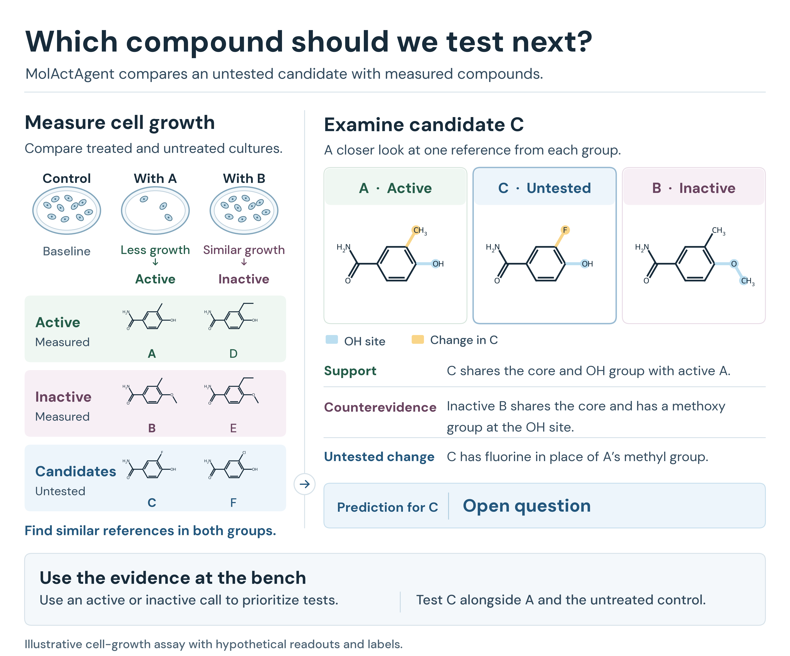

# MolActAgent

When you have several compounds to test and only a few experiments to spare, MolActAgent helps you decide what to measure next. It is an open-source AI agent for assessing compound bioactivity using the structures and results you already have for an assay. For each candidate, it shows which measured compounds support the assessment, where comparisons disagree, and what still needs measuring.

Live predictions require a language model available through an OpenAI-compatible Chat Completions API. You can use a hosted or locally served model.

[Project website](https://studentiz.github.io/MolActAgent/) · [Tutorial](docs/tutorial.md) · [Changelog](CHANGELOG.md)



## Installation

Use Git and Python 3.12 for the tagged example environment. The package supports Python 3.10–3.12.

```bash
git clone --branch v0.5.1 https://github.com/studentiz/MolActAgent.git
cd MolActAgent
python3.12 -m venv .venv
source .venv/bin/activate
python -m pip install -e ".[chem]" -c examples/molecular/constraints.txt
molactagent --version
```

Run the commands below from the `MolActAgent` folder. [Windows setup](docs/tutorial.md#install-the-example-environment)

<a name="start-here"></a>
<a name="quick-start-with-smiles"></a>
<a name="use-your-own-data"></a>

## Start with your own assay

### Data requirements

Choose one assay and define the activity classes under the same conditions. Export the following files from your lab records. SMILES is the text representation of the compound structure.

| File | Contents |
| --- | --- |
| `reference.csv` | Columns `id,smiles,label`. Give each compound a unique ID and include measured examples of both `active` and `inactive`. |
| `query.csv` | Columns `id,smiles`. Give each candidate one row and a unique ID. |
| `assay.txt` | Describe what the assay measures, the units and conditions, and your rules for assigning labels. |

An optional `name` column makes reports easier to read. If your references have pChEMBL measurements, add a `pchembl` column and pass `--pchembl-column pchembl` to supply those values to the model. Use `measurement` for original values with units and `source_url` for links shown in the HTML reference records. [Molecular input options](docs/tutorial-reference.md#molecular-cli)

### Configuration

Create a settings file for your model provider.

```bash
molactagent init-config --path llm_config.jsonc
```

Open the file and fill in `api_key`, `base_url` (your provider's API root), and `model_name`. Keep the API key private. The service receives your assay description and selected compound evidence.

You can supply the connection fields through `MOLACTAGENT_API_KEY`, `MOLACTAGENT_BASE_URL`, and `MOLACTAGENT_MODEL` instead. If you use environment variables, you can omit `--llm-config` below. Values resolve per field in this order. Explicit CLI flags win, then environment variables, then the file. [Profiles, local models, and settings](docs/tutorial-reference.md#model-and-api-configuration)

<a name="command-line-usage"></a>

### Run a live prediction

```bash
molactagent molecular \
  --reference reference.csv \
  --test query.csv \
  --id-column id \
  --endpoint @assay.txt \
  --llm-config llm_config.jsonc \
  --max-tokens 16384 \
  --record assay-responses.json \
  --output-dir assay-output
```

The token budget overrides the starter file's value. Use `--workers 1` if your service needs one request at a time. Use `--plain-json` if it rejects the API's JSON-mode option. Choose fresh output and recording paths for another run.

### Read the chemistry behind the decision

Open `assay-output/report.html` and follow a citation to inspect the reference structure and its label or measured value. Ask whether the part of the structure that changed has been tested in an otherwise similar compound. If other substitutions changed at the same time, or opposing references point to a different class, use that gap to choose a comparison to measure. Treat the score as support within the run.

The CLI also writes `assay-output/predictions.json` with decisions, references, individual judgments, and call metadata. `Inconclusive` can mean a missing reference class or too few usable or agreeing judgments. The report gives the reason. The command returns exit code `4` for an inconclusive query and still writes both outputs. Keep `assay-responses.json` with the input files to replay the recorded calls. [Report guide](docs/reports.md#reports-from-smiles)

### Run the same assessment from Python

Use the same input files and configuration from a script or notebook. The result records expose the references, individual judgments, and reason for an inconclusive decision.

```python
from pathlib import Path

import pandas as pd

import molactagent as ma
from molactagent.molecular import MolecularClassifier

reference = pd.read_csv("reference.csv", dtype=str, keep_default_na=False)
query = pd.read_csv("query.csv", dtype=str, keep_default_na=False)
config = ma.load_llm_config(max_tokens=16384)
classifier = MolecularClassifier(
    ma.build_llm_client(config),
    endpoint=Path("assay.txt").read_text(encoding="utf-8").strip(),
    temperature=config.temperature,
    max_tokens=config.max_tokens,
)
classifier.fit(reference, id_column="id")

for result in classifier.predict(query, id_column="id"):
    print(result.identifier, result.label, result.reason)
```

[More Python options](docs/tutorial-reference.md#python-interfaces)

## Quick start with numeric tables

If you already have numeric measurements or descriptors for each row, use the numeric-table engine for two or more classes. Put the same feature columns in both files, add a label column to the reference file, and use IDs unique across both tables. The bundled Iris files demonstrate three classes. Validate the files first without contacting a model, then run a prediction with your settings.

```bash
molactagent validate \
  --reference examples/iris_flowers/reference.csv \
  --test examples/iris_flowers/test.csv \
  --label-column species --id-column flower_id

molactagent run \
  --reference examples/iris_flowers/reference.csv \
  --test examples/iris_flowers/test.csv \
  --label-column species --id-column flower_id --task classification \
  --feature-descriptions examples/iris_flowers/feature_descriptions.json \
  --background @examples/iris_flowers/background.txt \
  --llm-config llm_config.jsonc --output-dir iris-output
```

Open `iris-output/summary.csv` for labels and `interpretability.html` for the vote and feature evidence. Use `--per-sample --per-sample-format json` for a detailed record per query. From Python, use `MolActAgentClassifier` for `fit`, `predict`, vote shares through `predict_proba`, and evidence through `predict_full`. Use `run_classification` to write the same batch reports as the CLI. [Iris and Python walkthrough](docs/tutorial.md#iris-tutorial-for-numeric-tables) · [Numeric inputs and outputs](docs/tutorial-reference.md#numeric-table-inputs)

## Architecture

The molecular engine retrieves nearby active and inactive compounds using fingerprint similarity. It checks whether model judgments cite usable evidence from the compounds shown and combines the usable votes. The numeric engine selects candidate classes for each query by looking at nearby rows. Each model comparison includes one row per candidate class. Numerical checks and weighted votes determine the result. [Design notes](docs/design.md)

<a name="reproduce-the-report-offline"></a>

## Optional worked example

Follow a public CDK2 assay example with the included input tables and the same live command pattern. The recorded result illustrates how an inconclusive decision can point to a useful next measurement. You can open the report or replay the saved responses with the pinned environment. [Worked example](docs/tutorial.md#optional-worked-example) · [CDK2 report](https://studentiz.github.io/MolActAgent/cdk2-report.html)

The historical teaching example uses synthetic labels to illustrate a structure comparison. v0.5.1 can replay its v0.5.0 schema 2 recording with matching inputs and RDKit. [Offline commands](docs/tutorial.md#replay-a-complete-prediction) · [Historical teaching report](https://studentiz.github.io/MolActAgent/molecular-example.html)

## Interactive chemical evidence reports

The saved-record viewer for numeric classifications shows the prediction, supporting and opposing comparisons, and the original decision record. Try it offline with the included illustrative data.

```bash
python examples/evidence_report/render.py
```

Open `examples/evidence_report/outputs/evidence_report.html` in a browser. To render your own saved record, add `report_context` and pass it to `ma.render_html_report`. [Saved record and context schema](docs/reports.md#export-your-own-saved-classification)

## Documentation and development

- Look up flags and exit codes, pipe structured output, and troubleshoot inputs or API settings. [Tutorial reference](docs/tutorial-reference.md)
- Explore continuous targets through the experimental numeric regression interface. [Experimental regression](docs/experimental-regression.md)
- Follow the development setup for optional readers and Conda. [Development and tests](docs/tutorial-reference.md#development-and-tests) · [Contributing](CONTRIBUTING.md)

Run the offline tests from an active environment at the repository root.

```bash
python -m pip install -e ".[chem,test]"
python -m pytest -q -m "not real_llm"
```

## License

The software is available under the MIT license. The CDK2 example attributes its source data and the terms for reuse. [Software license](LICENSE) · [Example data](examples/cdk2/README.md) · [Citation information](CITATION.cff)

## What's new in v0.5.1

- Review a candidate alongside the closest cited examples from each class. Reports show the recorded case for a class, reasons to doubt it, original reference measurements and links when supplied.
- Inspect a structural change directly. When two displayed molecules differ at a single unambiguous terminal atom, the same attachment site is marked on both structures.
- Start with your own assay in the live prediction tutorial. The command and Python references cover numeric tables, multiple classes, batch output and troubleshooting.
- Inspect a complete public run with measured references, original responses and an inconclusive outcome. v0.5.1 also reads the v0.5.0 molecular recording using the matching inputs and RDKit.

v0.5.0 added citation validation, explicit abstention and checks on the number of usable judgments. v0.4.1 introduced structure-based HTML reports. v0.4.0 introduced molecular prediction directly from SMILES. [Full version history](CHANGELOG.md)
