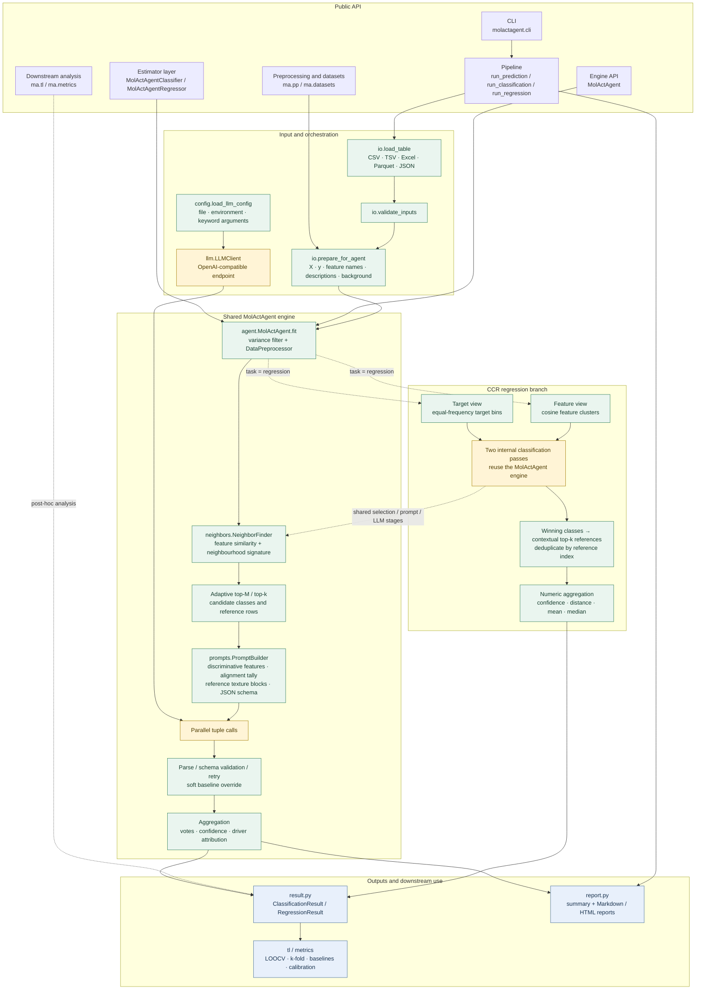

# MolActAgent

Small-data molecular activity prediction with explicit reference comparisons.

[](https://github.com/studentiz/MolActAgent/actions/workflows/tests.yml) [](https://www.python.org/) [](LICENSE)

MolActAgent is a Python package for classification and regression when the labelled dataset is small. It combines deterministic feature-space comparisons with an OpenAI-compatible language model. For each test sample, the package selects nearby reference rows, asks the model to compare them, and returns the prediction together with the rows and feature-level details used in the decision.

> MolActAgent is research software. A model-generated explanation is not an independent scientific citation, and the confidence score is not a calibrated probability. Validate results against suitable baselines and domain knowledge before using them in a real study.

## Start here

| If you want to... | Read |
| --- | --- |
| Run the first example from installation to prediction | [Tutorial](docs/tutorial.md) |
| Understand the engine, regression backend, result schema, and design decisions | [Design notes](docs/design.md) |
| Explore a full evidence report without an API key | [HTML report guide](docs/reports.md) · [Offline example](examples/evidence_report) |

The tutorial is the practical entry point. The design notes are the technical reference. The rest of this README is a compact orientation to both.

## What is included

| Part | Purpose |
| --- | --- |
| `MolActAgentClassifier` | scikit-learn-style classification with `fit`, `predict`, `predict_proba`, and `score` |
| `MolActAgentRegressor` | Regression through the package's cross-classification backend, with intervals and confidence scores |
| `run_classification` / `run_regression` | File-oriented pipelines that validate inputs and write summary and interpretability reports |
| `molactagent` CLI | Validation, batch prediction, JSON/CSV/JSONL output, and config-file setup |
| `ma.pp` and `ma.datasets` | Tabular preprocessing, SMILES featurisation, and bundled examples |

The core input is a numeric table. Chemistry helpers can convert SMILES to RDKit descriptors, MACCS keys, Morgan fingerprints, and scaffolds before prediction.

## Architecture

The public interfaces are thin layers around one shared prediction engine. Python owns input validation, preprocessing, reference selection, response checks, and aggregation. The language model is used inside the structured comparison stage.



The detailed rationale and call graph are in [docs/design.md](docs/design.md), especially [§11 Module map and data flow](docs/design.md#11-module-map-and-data-flow), [§18 Aggregation](docs/design.md#18-stage-7--aggregation-calibration-attribution), and [§19 CCR regression](docs/design.md#19-the-ccr-regression-backend).

## Installation

MolActAgent is currently installed from the source repository.

```bash
git clone https://github.com/studentiz/MolActAgent.git
cd MolActAgent

python -m venv .venv
source .venv/bin/activate       # Windows PowerShell: .venv\Scripts\Activate.ps1

python -m pip install --upgrade pip
python -m pip install -e .
```

For SMILES and RDKit-based examples:

```bash
python -m pip install -e ".[chem]"
```

For a reproducible Conda environment with the optional readers, chemistry tools, baselines, and test dependencies:

```bash
conda env create -f environment.yml
conda activate molactagent_env
python -m pip install -e .
```

Check the installation:

```bash
python -c "import molactagent as ma; print(ma.__version__)"
```

The bundled datasets live in the source checkout, so use an editable install when following the examples below.

## Quick start: classification

Set the credentials for an OpenAI-compatible endpoint. Keep the key in your shell environment or a local config file; do not commit it.

```bash
export MOLACTAGENT_API_KEY="your-api-key"
export MOLACTAGENT_BASE_URL="https://api.deepseek.com"
export MOLACTAGENT_MODEL="your-model-name"
```

Then run the bundled iris example:

```python
import molactagent as ma

iris = ma.datasets.load_iris_flowers()

clf = ma.MolActAgentClassifier(k=3, max_workers=4)
clf.fit(iris.X_train, iris.y_train)

labels = clf.predict(iris.X_test)
print(labels)
```

The estimator resolves the three `MOLACTAGENT_*` variables automatically. `X_train` and `y_train` are the labelled reference set; `X_test` contains the rows to predict.

To inspect a complete result instead of only the labels:

```python
result = clf.predict_full(iris.X_test)[0]

print(result.label)
print(result.confidence)
print(result.reference_info)
print(result.driver_attribution)
print(result.vote_summary)
```

`predict_proba` is a normalised weighted-vote distribution. It is useful for comparing the classes considered by the engine, but it should not be read as a statistically calibrated probability without an external calibration study.

## Quick start: SMILES regression

Install the chemistry extra first:

```bash
python -m pip install -e ".[chem]"
```

The BSLT example converts SMILES to features and then uses the regression estimator:

```python
import molactagent as ma

data = ma.datasets.load_bslt_regression(
    descriptors=True,
    maccs=True,
    morgan=False,
)

reg = ma.MolActAgentRegressor(
    target_name="standard_value",
    feature_names=data.feature_names,
    feature_descriptions=data.feature_descriptions,
    background=ma.pp.chemistry.BSLT_BACKGROUND,
    k=3,
    max_workers=4,
)
reg.fit(data.X[:-4], data.y[:-4])
predictions, lower, upper = reg.predict_with_interval(data.X[-4:])
```

Regression is implemented by the cross-classification backend: the target is viewed through binned and feature-derived classification phases, and the selected reference targets are recombined into a numeric estimate. Compare it with an appropriate conventional regression baseline for your dataset.

## Command-line usage

Create a local JSONC config file and replace its placeholder values:

```bash
molactagent init-config --path llm_config.jsonc
```

Validate the bundled iris inputs without making an LLM call:

```bash
molactagent validate \
  --reference examples/iris_flowers/reference.csv \
  --test examples/iris_flowers/test.csv \
  --label-column species \
  --id-column flower_id
```

Run the classification pipeline:

```bash
molactagent run \
  --reference examples/iris_flowers/reference.csv \
  --test examples/iris_flowers/test.csv \
  --label-column species \
  --id-column flower_id \
  --feature-descriptions examples/iris_flowers/feature_descriptions.json \
  --background @examples/iris_flowers/background.txt \
  --llm-config llm_config.jsonc \
  --output-dir outputs
```

The default run writes `summary.csv`, `interpretability.md`, and `interpretability.html` to `outputs/`. Add `--per-sample` when per-row reports are needed. Use `--format jsonl`, `--format json`, `--format csv`, or `--format tsv` when another program should consume stdout.

## Interactive chemical evidence reports

The HTML evidence viewer keeps the complete decision trace accessible:
supporting and opposing evidence, every saved feature rationale, a
reference-comparison selector, numerical feature tables, weighted class
support and the original prediction JSON. Chemical names and feature
definitions make the recorded comparisons easier to read.

Try the clearly labelled illustrative example without an API key:

```bash
python examples/evidence_report/render.py
```

Open `examples/evidence_report/outputs/evidence_report.html` in a browser.
The example uses synthetic activity labels and handwritten explanations;
it is not an experimental result. Exporting a saved record requires no
additional LLM call.

The viewer is enabled by an optional `report_context` mapping passed in a
classification record to the existing `render_html_report` function.
The CLI's default output and regression reports keep their existing
behavior. See the [report guide](docs/reports.md) for the context schema
and instructions for your own predictions.

## Configuration

Credentials can be supplied in any one of these ways:

- `MOLACTAGENT_API_KEY`, `MOLACTAGENT_BASE_URL`, and `MOLACTAGENT_MODEL` environment variables;
- a JSONC, JSON, YAML, or legacy text config file passed with `--llm-config`;
- `ma.load_llm_config(...)` followed by `llm_config=...`;
- a pre-built `ma.LLMClient` passed as `llm_client=...`.

All examples use the canonical package alias `ma`:

```python
import molactagent as ma

config = ma.load_llm_config("llm_config.jsonc")
clf = ma.MolActAgentClassifier(llm_config=config)
```

Any provider that implements the OpenAI-compatible chat-completions interface can be used. The endpoint, model name, temperature, retry policy, and timeout are configuration values; MolActAgent does not bundle or require a particular provider.

## Data requirements

For a classification run, the reference table must contain:

- one unique identifier column;
- numeric feature columns shared with the test table;
- one label column with at least two classes.

For regression, the target column must be numeric. Feature descriptions and a short background file are optional, but they make the comparisons easier to interpret. See the files under [`examples/iris_flowers`](examples/iris_flowers) and [`examples/bslt`](examples/bslt) for complete layouts.

## Documentation and development

- [Tutorial](docs/tutorial.md) — a complete CLI and Python walkthrough;
- [Design notes](docs/design.md) — the engine, aggregation rules, result schema, and evaluation tools;
- [HTML report guide](docs/reports.md) — full evidence, named references and offline export;
- [Examples](examples) — small tabular and chemistry datasets;
- [Tests](tests) — offline tests plus opt-in real-endpoint smoke tests.

Run the offline test suite from the repository root:

```bash
python -m pytest -q
```

Real-endpoint tests are opt-in because they make external API calls and consume tokens. Set `MOLACTAGENT_REAL_LLM=1` only when you intend to run them.

## License

MIT. See [LICENSE](LICENSE).

If you use MolActAgent in research, see [CITATION.cff](CITATION.cff).
