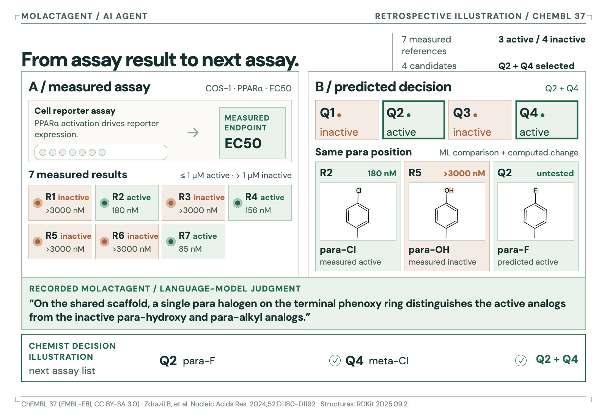

<p align="center"></p>

# MolActAgent

**An open-source AI agent for deciding which compounds to test next.** You have activity measurements for a few compounds and more candidates than you can assay. MolActAgent finds structurally similar compounds on both sides of your assay’s activity cutoff. A language model weighs their structural and physicochemical differences. For each candidate, you can see the prediction, inspect the experimental references, and judge which comparisons support taking it forward.

[](https://github.com/studentiz/MolActAgent/releases/tag/v0.6.0)
[](LICENSE)
[](https://github.com/studentiz/MolActAgent/actions/workflows/tests.yml)

[Project and film](https://studentiz.github.io/MolActAgent/) · [Open a complete assay report](https://studentiz.github.io/MolActAgent/cell-assay.html) · [Tutorial](docs/tutorial.md) · [Design](docs/design.md)

## What's new in v0.6.0

- Inspect a four-candidate cell-assay batch. Compare the predictions side by side, open the original measured references and follow the reasons for taking Q2 and Q4 forward.
- Molecular retrieval counts distinct structures. Matching replicate records stay attached to their representative. Reports distinguish chemical disagreement, model abstention and failed requests.
- Resume an interrupted live molecular batch from its completed compounds. New predictions use an OpenAI-compatible Chat Completions API. The starter configuration now provides a 16,384-token output budget.
- Numeric-table classifications retain the validated language model judgment and its reasons. Each local record includes the numerical alignment for comparison. Re-evaluating historical numeric inputs can produce a different class.

[Complete changelog and previous releases](CHANGELOG.md)

<picture>
  <source media="(max-width: 672px)" srcset="docs/assets/assay-poster-mobile.png">
  
</picture>

The figure follows a retrospective cell reporter assay. The agent saw seven measured reference classes and four candidate structures. The example includes the four held-back measurements, the exact inputs and the saved model responses. [Case data and sources](examples/cell-assay)

## Installation

Use Git and Python 3.12 for the tagged example environment. The package supports Python 3.10–3.12.

```bash
git clone --branch v0.6.0 https://github.com/studentiz/MolActAgent.git
cd MolActAgent
python3.12 -m venv .venv
source .venv/bin/activate
python -m pip install -e ".[chem]" -c examples/molecular/constraints.txt
molactagent --version
```

Run the commands below from the `MolActAgent` folder. [Windows setup](docs/tutorial.md#install-the-example-environment)

<a name="start-here"></a>
<a name="quick-start-with-smiles"></a>
<a name="use-your-own-data"></a>

## Start with your own assay

### Data requirements

Choose one assay and define the activity classes under the same conditions. Export the following files from your lab records. SMILES is the text representation of the compound structure.

| File | Contents |
| --- | --- |
| `reference.csv` | Columns `id,smiles,label`. Give each compound a unique ID and include measured examples of both `active` and `inactive`. |
| `query.csv` | Columns `id,smiles`. Give each candidate one row and a unique ID. |
| `assay.txt` | Describe what the assay measures, the units and conditions, and your rules for assigning labels. |

An optional `name` column makes reports easier to read. If your references have pChEMBL measurements, add a `pchembl` column and pass `--pchembl-column pchembl` to supply those values to the model. Use `measurement` for original values with units and `source_url` for links shown in the HTML reference records. [Molecular input options](docs/tutorial-reference.md#molecular-cli)

### Configuration

Create a settings file for your model provider.

```bash
molactagent init-config --path llm_config.jsonc
```

Open the file and fill in `api_key`, `base_url` (your provider's API root), and `model_name`. Keep the API key private. The service receives your assay description and selected compound evidence.

You can supply the connection fields through `MOLACTAGENT_API_KEY`, `MOLACTAGENT_BASE_URL`, and `MOLACTAGENT_MODEL` instead. If you use environment variables, you can omit `--llm-config` below. Values resolve per field in this order. Explicit CLI flags win, then environment variables, then the file. [Profiles, local models, and settings](docs/tutorial-reference.md#model-and-api-configuration)

<a name="command-line-usage"></a>

### Run a live prediction

Try the published cell assay with the API settings you just created. Run from the repository root.

```bash
molactagent molecular \
  --reference examples/cell-assay/reference.csv \
  --test examples/cell-assay/query.csv \
  --id-column id --endpoint @examples/cell-assay/endpoint.txt \
  --llm-config llm_config.jsonc \
  --record assay-responses.json --output-dir assay-output
```

To use your own assay, replace the two CSV paths with `reference.csv` and `query.csv` and the endpoint with `@assay.txt`. Keep the assay description, structures and both experimental classes from the same endpoint. A live service receives the assay description and selected molecular evidence.

If interrupted, repeat the same command with `--resume`. Completed compounds are recovered from `assay-output/.molactagent/`. Keep this folder with your results while resuming. Choose fresh output and recording paths to start an independent run. [Input and service options](docs/tutorial-reference.md#molecular-cli)

### Read the chemistry behind the decision

Open `assay-output/report.html` and follow a citation to inspect the reference structure and its label or measured value. Ask whether the part of the structure that changed has been tested in an otherwise similar compound. If other substitutions changed at the same time, or opposing references point to a different class, use that gap to choose a comparison to measure. Treat the score as support within the run.

The CLI also writes `assay-output/predictions.json` with decisions, references, individual judgments, and call metadata. `Inconclusive` can mean a missing reference class or too few usable or agreeing judgments. The report gives the reason. The command returns exit code `4` for an inconclusive query and still writes both outputs. Keep `assay-responses.json` with the input files to replay the recorded calls. [Report guide](docs/reports.md#reports-from-smiles)

### Run the same assessment from Python

Use the same input files and configuration from a script or notebook. The result records expose the references, individual judgments, and reason for an inconclusive decision.

```python
from pathlib import Path

import pandas as pd

import molactagent as ma
from molactagent.molecular import MolecularClassifier

reference = pd.read_csv("reference.csv", dtype=str, keep_default_na=False)
query = pd.read_csv("query.csv", dtype=str, keep_default_na=False)
config = ma.load_llm_config("llm_config.jsonc", max_tokens=16384)
classifier = MolecularClassifier(
    ma.build_llm_client(config),
    endpoint=Path("assay.txt").read_text(encoding="utf-8").strip(),
    temperature=config.temperature,
    max_tokens=config.max_tokens,
)
classifier.fit(reference, id_column="id")

for result in classifier.predict(query, id_column="id"):
    print(result.identifier, result.label, result.reason)
```

[More Python options](docs/tutorial-reference.md#python-interfaces)

## Quick start with numeric tables

If you already have numeric measurements or descriptors for each row, use the numeric-table engine for two or more classes. Put the same feature columns in both files, add a label column to the reference file, and use IDs unique across both tables. The bundled Iris files demonstrate three classes. Validate the files first without contacting a model, then run a prediction with your settings.

```bash
molactagent validate \
  --reference examples/iris_flowers/reference.csv \
  --test examples/iris_flowers/test.csv \
  --label-column species --id-column flower_id

molactagent run \
  --reference examples/iris_flowers/reference.csv \
  --test examples/iris_flowers/test.csv \
  --label-column species --id-column flower_id --task classification \
  --feature-descriptions examples/iris_flowers/feature_descriptions.json \
  --background @examples/iris_flowers/background.txt \
  --llm-config llm_config.jsonc --output-dir iris-output
```

Open `iris-output/summary.csv` for labels and `interpretability.html` for the vote and feature evidence. Use `--per-sample --per-sample-format json` for a detailed record per query. From Python, use `MolActAgentClassifier` for `fit`, `predict`, vote shares through `predict_proba`, and evidence through `predict_full`. Use `run_classification` to write the same batch reports as the CLI. [Iris and Python walkthrough](docs/tutorial.md#iris-tutorial-for-numeric-tables) · [Numeric inputs and outputs](docs/tutorial-reference.md#numeric-table-inputs)

## Architecture

The molecular engine uses fingerprint similarity to retrieve neighbors from both measured classes. The language model compares these references with the candidate in the context of the assay. The agent checks the response and its reference identifiers, then combines the usable judgments. The numeric engine selects candidate classes using nearby rows. Each comparison includes one row per candidate class. The language model interprets the measurements, and the engine checks the cited values before counting its class vote. [Design notes](docs/design.md)

<a name="reproduce-the-report-offline"></a>

## When the evidence is inconclusive

Follow a public CDK2 assay example with the included input tables and the same live command pattern. The recorded result illustrates how an inconclusive decision can point to a useful next measurement. You can open the report or replay the saved responses with the pinned environment. [Worked example](docs/tutorial.md#optional-worked-example) · [CDK2 report](https://studentiz.github.io/MolActAgent/cdk2-report.html)

The historical teaching example uses synthetic labels to illustrate a structure comparison. v0.6.0 can replay its v0.5.0 schema 2 recording with matching inputs and RDKit. [Offline commands](docs/tutorial.md#replay-a-complete-prediction) · [Historical teaching report](https://studentiz.github.io/MolActAgent/molecular-example.html)

## Interactive chemical evidence reports

The saved-record viewer for numeric classifications shows the prediction, supporting and opposing comparisons, and the original decision record. Try it offline with the included illustrative data.

```bash
python examples/evidence_report/render.py
```

Open `examples/evidence_report/outputs/evidence_report.html` in a browser. To render your own saved record, add `report_context` and pass it to `ma.render_html_report`. [Saved record and context schema](docs/reports.md#export-your-own-saved-classification)

## Documentation and development

- Look up flags and exit codes, pipe structured output, and troubleshoot inputs or API settings. [Tutorial reference](docs/tutorial-reference.md)
- Explore continuous targets through the experimental numeric regression interface. [Experimental regression](docs/experimental-regression.md)
- Follow the development setup for optional readers and Conda. [Development and tests](docs/tutorial-reference.md#development-and-tests) · [Contributing](CONTRIBUTING.md)

Run the offline tests from an active environment at the repository root.

```bash
python -m pip install -e ".[chem,test]"
python -m pytest -q -m "not real_llm"
```

## License

The software is available under the MIT license. The cell-assay and CDK2 examples attribute their ChEMBL records and state the applicable data terms. [Cell-assay attribution](examples/cell-assay) [Software license](LICENSE) · [Example data](examples/cdk2/README.md) · [Citation information](CITATION.cff)
