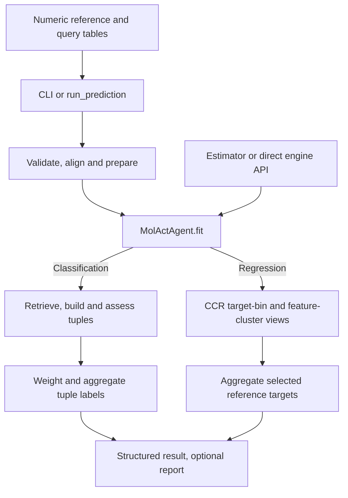

# Feature-table engine design and reference

This reference follows the v0.5.1 implementation from prepared numeric
tables to structured class judgments and experimental regression estimates.
For the assay workflow and the differences between the two prediction engines,
see [Design overview](design.md#feature-table-engine).

- [Module map and data flow](#module-map-and-data-flow)
- [Pipeline and input contract](#pipeline-and-input-contract)
- [Preprocessing and contextual retrieval](#preprocessing-and-contextual-retrieval)
- [Tuple construction and assessment](#tuple-construction-and-assessment)
- [Aggregation and result fields](#aggregation-and-result-fields)
- [Experimental cross-classification regression](#experimental-cross-classification-regression)
- [Defaults and configuration](#defaults-and-configuration)
- [Public Python interfaces](#public-python-interfaces)

## Module map and data flow

| Module | Responsibility |
| --- | --- |
| [`cli.py`](../molactagent/cli.py) | Argument parsing, table input from a file or stdin, model configuration, exit status and stdout formatting. |
| [`pipeline.py`](../molactagent/pipeline.py) | Orchestrate loading, validation, model preflight, fitting, per-query prediction and optional output. |
| [`io.py`](../molactagent/io.py) | Read tables and descriptions, detect the task, validate inputs and align feature columns. |
| [`agent.py`](../molactagent/agent.py) | Fit the feature-table engine, construct and score classification tuples, or dispatch numeric targets to CCR. |
| [`preprocessing.py`](../molactagent/preprocessing.py) and [`neighbors.py`](../molactagent/neighbors.py) | Fit the internal scaler and cache reference neighborhoods. Retrieve local references and select candidate classes. |
| [`prompts.py`](../molactagent/prompts.py) | Format evidence, response contracts, correction messages and the optional explanation prompt. |
| [`config.py`](../molactagent/config.py) and [`llm.py`](../molactagent/llm.py) | Resolve and build a Chat Completions client. Handle transport retries, output settings, timing and call statistics. |
| [`cross_classification.py`](../molactagent/cross_classification.py) | Fit the two views for experimental regression, select references and aggregate observed target values. |
| [`result.py`](../molactagent/result.py), [`report.py`](../molactagent/report.py) and [`_evidence_report.py`](../molactagent/_evidence_report.py) | Wrap result dictionaries and render per-query or batch evidence. |
| [`estimators/`](../molactagent/estimators) | Adapt the same engine to the scikit-learn-style fit, predict and score interface. |



The regression views each run the classification path internally. The
estimators accept feature matrices and targets directly and use the same
prediction code. The pipeline also handles file validation, report output
and batch-level error reporting.

## Pipeline and input contract

### Load, validate and prepare

The pipeline accepts pandas DataFrames or paths. `load_table` handles CSV,
TSV, delimiter-detected text, Excel, Parquet and JSON or JSONL. Excel and
Parquet depend on the applicable pandas reader. The CLI also accepts one
input from stdin using `-` and `--stdin-format csv` or `tsv`.
`load_feature_descriptions` reads a column-to-text mapping.
`load_background` accepts text or an `@file` reference.

The reference label column determines the detected task. Text and Boolean
labels are classes. A numeric column is treated as classification if it
has at most ten distinct integer-valued labels. Fractional values or more
than ten distinct numeric values route to regression. `run_prediction`
checks any explicit `task` against the detected one. Its convenience
functions `run_classification` and `run_regression` assert the corresponding
task. To choose directly, use the corresponding estimator or call
`MolActAgent.fit(..., task=...)` on arrays.

`validate_inputs` returns a `ValidationResult` with `is_valid`, `errors`,
`warnings` and `summary`. `molactagent validate` exercises the table checks
offline. The checks cover these inputs.

| Input | Handling |
| --- | --- |
| Reference labels | Required and nonmissing. Classification needs at least two classes. Numeric pipeline validation requires at least three distinct regression targets with a nonzero range. |
| Query labels | Optional. Values are carried through as known outcomes for reporting when supplied. The engine selects references and evaluates queries from features. |
| Feature columns | Each reference feature must be present in the query table. Reference column names establish feature order. Extra query columns generate a warning and are ignored. |
| IDs | `--id-column` is required by the feature-table CLI and optional in the Python pipeline. When specified, both tables need non-empty, unique IDs with no overlap between tables. IDs become the row identifiers in prepared data and are removed from the feature matrix. |
| Description mapping | If supplied, include every reference column except the ID, including the label or target column. Extra keys generate a warning. |
| `k` and class coverage | `k` must be a positive integer. A class with fewer than `k` references supplies its available rows. |
| Background | Free-text input supplies context to the prompt. Long text generates a validation warning. |

`prepare_for_agent` excludes the identifier and target from the features,
drops entirely missing reference columns, coerces features to numeric
arrays and preserves the query row IDs. For classification it normalizes
labels to strings for the engine. `positive_class` is accepted for
compatibility and ignored by the engine's class selection. The pipeline
uses `PreparedData` to carry the matrices, labels or targets, feature names,
descriptions, task and optional known query outcomes.
[Validation and preparation source](../molactagent/io.py)

### Run the model and write outputs

1. `run_prediction` validates and prepares the inputs. On validation
   failure it returns a `PipelineOutput` with the validation record and no
   outcomes, or raises if `raise_on_validation_error=True`.
2. It prefers a supplied `llm_client` and otherwise builds from `llm_config`.
   With `verify_llm=True`, the default, it calls `ping` if the client
   provides it. The CLI resolves model configuration before invoking the
   pipeline. An endpoint preflight checks the connection and model name.
3. It fits one `MolActAgent` for the run, then iterates over queries.
   Classification tuples within a query can run concurrently. The
   pipeline calls the progress callback with the completed query count,
   total count and `SampleOutcome` when a callback is supplied.
4. An optional per-sample HTML or Markdown report requests a separate
   narrative from the model. JSON-only per-sample output saves the engine
   result directly. Batch interpretability uses evidence already in the
   outcome records.
5. `PipelineOutput` returns validation, outcomes, output paths where written,
   interpretability text and available LLM statistics. `SampleOutcome`
   carries `sample_id`, `predicted_label`, `confidence`, the full
   `raw_result`, optional truth, paths, elapsed time and any error. Regression
   outcomes also carry the numeric value and interval.

A query exception becomes a `SampleOutcome` with an error and the display
label `Error`, and later queries can still run. A model-side tuple failure
can instead become an `Unknown` tuple inside a completed classification.
`PipelineOutput.n_succeeded` counts outcomes with no recorded error,
including `Inconclusive` classifications and regression refusals. Inspect
the verdicts or numeric values to count decisive predictions. Numeric CLI
`run` returns status 4 when any outcome records an error.

An output directory enables `summary.csv` and batch interpretability
files by default. `summary.json` is opt-in and contains summary rows and
run metadata. Inspect `outcome.raw_result` or per-sample JSON for the full
comparison record. The standalone HTML renderer can read that record
directly. [Pipeline source](../molactagent/pipeline.py) · [CLI outputs](tutorial-reference.md#numeric-table-outputs) · [Report guide](reports.md#reports-from-numeric-tables)

## Preprocessing and contextual retrieval

### Fit on the reference matrix

`MolActAgent.fit` filters columns using `np.var(X_ref, axis=0) >
variance_threshold` and applies the same column mask to new queries. The
default threshold of zero removes constant columns. A reference column
whose computed variance is NaN also fails this filter. Fit preprocessing
on reference rows so query values cannot influence retrieval scaling.

`DataPreprocessor` fits standard scaling by default. `minmax` maps
reference values into the fitted feature ranges, and `none` leaves units
unchanged. Where the preprocessor needs to fill missing values for
retrieval, it uses medians from its fitted reference columns. The
classifier normally sends the retained values in their original units
to the tuple prompt. Set `use_scaled_for_prompt=True` in the engine or
estimator to send the transformed representation for both alignment and
model interpretation. Use the same representation when supplying
reference values for a saved report.
[Fit source](../molactagent/agent.py) · [Preprocessor source](../molactagent/preprocessing.py)

### Contextual similarity

`NeighborFinder.fit` calculates an all-pairs distance matrix on the
transformed reference features. For each reference, the
`NeighborhoodSignature` cache stores its closest `k_local` other
reference indices and distances. A query's signature is computed against
the reference matrix when predicting. The signatures depend on feature
geometry. Class labels determine the pools used after similarity
calculation.

With `D` equal to the largest fitted off-diagonal distance, subject to
the code's floor for zero, and `d` the feature-space distance, the direct
feature similarity is `max(0, 1 − d / D)`. For two neighborhoods, compute
the pairwise distances between their points. Average the minimum
distances from the first neighborhood to the second and separately from
the second to the first. Average those two means to obtain the
neighborhood distance `d_N`. Neighborhood similarity is
`max(0, 1 − d_N / D)`, or zero if either signature is empty.

```text
similarity = similarity_blend × feature_similarity
           + (1 − similarity_blend) × neighborhood_similarity
contextual_distance = 1 − similarity
```

The two neighborhood passes make the neighborhood comparison symmetric.
Each point contributes its closest counterpart, so points can share a
counterpart. The default blend gives equal weight to direct similarity and
similarity of the surrounding reference features. For example, two
reference points with normalized feature distance `0.20` and identical
cached neighborhoods have direct similarity `0.80`, neighborhood
similarity `1.00` and blended similarity `0.90`. With a small reference
set, the available points constrain which neighborhoods can be compared.

### Select references and candidate classes

- `find_local_references` sorts rows within each class by contextual
  distance and keeps up to `k`. The returned `NeighborResult` tracks
  picked indices, contextual distances, direct feature distances and
  near-identity flags.
- `select_top_m_classes` ranks classes by their closest retrieved row.
  For more than two available classes, the default distance cutoff is
  `1.5 × max(best contextual distance, 1e-6)`. When fewer than two
  qualify, it takes the two closest. The result is capped by `max_m`
  (default four). A binary problem uses both available classes.
- `find_top_k_references` is the flat retrieval method used by CCR.
  It returns indices and both distance measures sorted by contextual
  similarity. CCR filters this ordering by its selected class.

Classes outside the candidate set receive no tuples for that query.
The direct near-identity flags are diagnostic. Classification applies
its separate near-identity filter to the tuple's actual prompt vectors.
[Retrieval source](../molactagent/neighbors.py)

## Tuple construction and assessment

### Build the evidence

The engine takes the Cartesian product of the candidate-class reference
pools. A tuple has one reference from each candidate class and the query.
The number of potential tuples is the product of the pool sizes. A tuple
is excluded if any reference matches the query vector under
`np.allclose(..., atol=1e-6)` in the representation used for the prompt.
This check works on numeric vectors and can also exclude two distinct
structures with indistinguishable supplied features.

For a retained tuple, a feature is discriminative if its values differ
across the references. Give one alignment count to the class whose
reference is uniquely closest to the query by absolute difference on
that feature. An exact tie contributes to `n_neutral`. The unique
positive leader in `n_aligned` becomes `baseline_class`. A tied or
zero tally gives `Unknown`. If all reference values are identical, the
tuple returns `Unknown` without calling the model.

Here is an illustrative alignment calculation with four retained
descriptors.

| Feature | Query | Active reference | Inactive reference | Alignment |
| --- | --- | --- | --- | --- |
| Molecular weight (Da) | 315 | 320 | 305 | Active |
| Polar surface area (Ų) | 52 | 46 | 54 | Inactive |
| Hydrogen-bond donors | 1 | 2 | 0 | Neutral |
| Hydrogen-bond acceptors | 4 | 4 | 2 | Active |

The tally is two active, one inactive and one neutral. The tuple's
numeric baseline is active. The engine also gives the model the labeled
neighbor rows around each selected reference. These show whether a
reference is surrounded by rows of its own class or sits near examples
of several classes. Feature definitions and assay background provide
context for choosing and explaining chemical drivers.

### Parse, validate and finalize the tuple

The prompt requests JSON with a class or `Unknown`, a model score, named
drivers, supporting and opposing features, counter-evidence and
uncertainty. The parser tries the response as JSON after trimming a
leading fence when present. It can also try a brace-delimited object
within the reply. The validator requires a recognized label and at
least two distinct valid driver entries that cite discriminative
features and candidate classes. It coerces and bounds scores and
driver strengths to 0–1, defaulting to 0.5 when a numeric field cannot
be read. The checks verify the response contract and the supplied
feature names. The saved explanations remain model interpretations.

| Response path | Effect on the saved tuple |
| --- | --- |
| Candidate label agrees with a clear baseline | Keep the label and the response score. |
| Candidate label conflicts with a clear baseline | Always save the baseline label. If driver strengths favoring the proposed label exceed those favoring the baseline by more than 1.0, the disagreeing response can pass validation on that point. Other disagreements prompt correction. |
| Valid `Unknown` response | Keep `Unknown`, including when the tally has a clear leader. |
| Valid candidate class with an `Unknown` baseline | Keep the model's class. |
| Validation attempts exhausted | Save the numeric baseline, alignment-derived fallback score and failure reason. The fallback has no model drivers. |
| Tuple evaluation raises an exception | Record `Unknown` and the failure reason. This tuple casts no class vote. |

By default, validation gets the initial response and up to three
correction attempts. The correction prompt includes the previous answer
and detected issues. `_finalize_tuple` enforces the class policy after
validation. The model's saved narrative and driver directions can
disagree with the resolved label. The result records both the numeric
baseline and the final tuple label for inspection.

Each tuple runs against the same fitted reference state. Per-query
concurrency is bounded by `min(max_workers, number of tuples)`. The
engine puts results back in input tuple order before aggregation.
Increasing `k` expands the candidate combinations and can increase
model calls substantially. Increasing `max_workers` changes concurrency.
Transport, response correction and tuple counts are separate.
[Tuple implementation](../molactagent/agent.py) · [Prompt construction](../molactagent/prompts.py)

## Aggregation and result fields

### Vote and confidence calculation

Tuple `class_scores` are the alignment counts divided by the total
non-neutral alignments, or uniform when no features align. These
per-feature proportions are separate from the weights used to aggregate
the tuple labels. For a successful response, the aggregator uses the
tuple's model score, with an effective default of 0.5 if the value is
missing or zero. If the tuple used the numerical validation fallback,
its recorded score is `0.4 + 0.5 × (best class proportion − runner-up
proportion)`. `Unknown` tuples contribute to coverage and add no class
weight.

The winning class must lead the runner-up by strictly more than
`0.05 × decisive tuple count`. For example, with five decisive tuples and
weight totals of `1.80` and `1.58`, the lead is `0.22`. The required lead
exceeds `0.25`, so the result is `Inconclusive`. With no decisive tuple,
the result is also `Inconclusive`.

For a winning class, the engine reports this heuristic.

```text
relative_margin = (winner_weight − runner_up_weight) / (winner_weight + runner_up_weight)
reference_size  = min(1, smallest_candidate_class_size / 10)
coverage        = decisive_tuples / evaluated_tuples
confidence      = (0.5 + 0.5 × relative_margin)
                × (0.5 + 0.25 × reference_size + 0.25 × coverage)
```

Class size comes from the fitted reference set. Coverage includes
evaluated `Unknown` tuples and excludes tuples skipped before evaluation.
An inconclusive aggregation has zero vote margin and returns the heuristic
value `0.4`. An empty pre-aggregation result has score zero.
`predict_proba` separately normalizes weighted class support. The
heuristic confidence and normalized support are uncalibrated.
[Aggregation implementation](../molactagent/agent.py) · [Result wrappers](../molactagent/result.py)

### Read a classification record

| Scope | Fields and interpretation |
| --- | --- |
| Query | `test_index`, `task`, `final_label`, `confidence` and `confidence_basis` identify the verdict and its score components. `test_feature_values` stores the retained query values used for the comparisons when available. |
| Retrieval | `candidate_classes` and `reference_info` describe the fitted reference pool, chosen reference indices per class, comparison count and query-matching tuple exclusions. |
| Local evidence | Each `tuple_results` entry contains `ref_indices`, `label`, `baseline_class`, `n_aligned`, `n_neutral`, `class_scores`, `confidence`, discriminative features, drivers, summary and any fallback reason or uncertainty. `ref_indices` are positions in the fitted reference matrix. |
| Aggregate | `vote_summary.per_class` contains counts and summed weights. `num_unknown` counts evaluated tuples without a class vote. `n_degenerate` counts tuples skipped for a near-identical query match. |
| Interpretation | `driver_attribution`, `key_features_per_class`, `supporting_evidence`, `opposing_evidence` and `uncertainty` summarize the recorded model text and drivers. Read them alongside the saved labels and vote totals. |

The attribution code sums the model's driver strengths by favored class
and counts citations. A feature is marked `Mixed` when its leading
strength exceeds the runner-up by at most 0.05. Features are sorted by
total cited strength and then citation count, and the aggregate retains
up to three rationales per feature. Individual tuples preserve their
own driver rationales. Driver rankings describe which features the
models cited. Causal interpretation requires experimental evidence.

## Experimental cross-classification regression

CCR is part of the feature-table engine. It remains experimental and
outside the accompanying manuscript's evaluation. For status and the
available entry points, see [Experimental regression support](experimental-regression.md).

### Fit the target and feature views

- **Target view.** Group the reference targets into approximately
  equal-frequency bins using `pandas.qcut`. Limit the number of
  requested bins by the number of distinct targets and drop duplicate
  edges. The fitted labels are `bin_0`, `bin_1` and so on, in target
  order.
- **Feature view.** Standardize the retained feature matrix, form
  cosine distances and apply average-linkage agglomerative clustering.
  The cluster labels are `fc_0`, `fc_1` and so on. Their numbers identify
  groups and carry no target order.

The default `n_mode="sqrt"` requests `floor(sqrt(n)) + 1` classes per
view, with the request bounded to `max(2, n − 1)` and floored at two.
The actual number of groups can be lower when values tie or the
reference set is very small. `sqrt-floor` uses `floor(sqrt(n))`,
`sqrt-capped-10` also caps that number at ten and `fixed` requests
five before applying the bounds. At the backend level, `n_target_bins` and
`n_feature_clusters` set the requested count independently. Through
`MolActAgent`, use the corresponding `ccr_n_target_bins` and
`ccr_n_feature_clusters` options.

The backend fits one `MolActAgent` classifier per view with Euclidean
distance, its own reference scaling and `agent_k` references per
candidate class. The inner classifiers inherit the normal adaptive
candidate-class cap of four. `k_per_class` is the separate number of
references drawn from the selected class after each view's prediction.
Both counts default to two. The outer regressor's `k` and `metric`
do not set these inner choices.
[View construction](../molactagent/cross_classification.py)

### Select targets and aggregate

1. Run classification once for the target-bin view and once for the
   feature-cluster view. If a view gives an inconclusive result and
   has a per-class vote summary, CCR can select the class with the
   largest recorded weight. The fallback can select a class even if
   all those weights are zero. Inspect the view's `final_label`
   alongside its `predicted_class`.
2. Draw up to `k_per_class` contextual nearest references from each
   selected class. For the merged evidence list, keep each reference
   index once, with its smallest contextual distance if selected by
   both views.
3. Compute the numeric estimate from the selected references' observed
   target values. With `aggregator="conf"`, a reference's contribution
   from a view is weighted by that view's reported classification
   confidence. If both views picked it, their contributions are
   summed before computing the weighted mean.
4. For `conf-distance`, divide each view's weight by its selected
   reference distance plus `1e-6`. The `mean`, `median` and `weighted`
   modes operate on the deduplicated list. `weighted` uses the inverse
   contextual distance with the same offset. CCR refuses when no
   references survive or the selected aggregation cannot produce a
   usable value.

### Read the regression record

| Field | Meaning |
| --- | --- |
| `predicted_value` and `interval` | The numeric estimate and the minimum and maximum of the selected reference targets. The interval describes their spread and carries no statistical coverage guarantee. A refusal gives `None` and `(None, None)`. |
| `phase_target` and `phase_feature` | The view's selected class, original classification label and confidence, candidate classes and chosen neighbor indices and distances. |
| `selected_indices`, `selected_targets`, `selected_distances` | Parallel lists for the merged references. `aggregator` records the rule that produced the estimate. |
| `confidence` and `confidence_basis` | The score is the mean of the classification scores for the views with selected classes. A refusal gives zero. The basis includes per-view details. |
| `phase_views_agree` | True if at least one reference was picked by both views. |
| `tuple_results` and `driver_attribution` | The outer result represents each contributing view as a report row and summarizes features cited in either view. |
| `reference_info` and `extrapolation_flagged` | Fitted target range, grouping and reference details, and whether the estimate lies outside the fitted target range. A refused result sets the flag and records its reason. |

The regression attribution combines cited strengths across the two
views. It labels a feature `increases` when its Pearson correlation with
the fitted target exceeds `0.15`, `decreases` below `−0.15` and `mixed`
otherwise. These directions describe reference-table associations.
[CCR inference and result source](../molactagent/cross_classification.py)

## Defaults and configuration

### Numeric entry points

| Setting | CLI `run` and pipeline | Classifier estimator | Regressor estimator | Direct `MolActAgent` |
| --- | --- | --- | --- | --- |
| `k` | 3 | 3 | 5 | 6 |
| `metric` | `euclidean` | `euclidean` | `euclidean` | `euclidean` |
| `scaler` | `standard` | `standard` | `standard` | `standard` |
| `max_workers` | 8 | 8 | 8 | 100 |
| Task | Detect from label column, optionally check a requested task | Classification | Regression | Detect from target array or pass `task` to `fit` |

`NeighborFinder` used directly has its own `k=5` default. When invoked by
the engine it receives that engine's `k` argument. In regression, the
inner `ccr_agent_k` and retrieval settings described above determine
the two classification views.

| Engine option | Default | Effect |
| --- | --- | --- |
| `variance_threshold` | `0.0` | Keep columns with reference variance strictly above the threshold. |
| `use_scaled_for_prompt` | `False` | Use original retained feature values for tuple contrasts and the prompt by default. |
| `k_local` | `3` | Size of the local neighborhood used for comparison and model context. |
| `similarity_blend` | `0.5` | Weight on direct feature similarity in contextual retrieval. |
| `m_threshold` | `1.5` | Distance multiplier for eligible candidate classes. |
| `max_m` | `4` | Maximum number of candidate classes in a classification view. |
| `max_check_retries` | `3` | Additional model requests after a failed tuple response check. |
| `llm_temperature` | `0.0` | Sampling temperature explicitly passed by the tuple and explanation calls. |
| `ccr_aggregator` | `"conf"` | Weighted mean using the two views' confidence scores. |
| `ccr_k_per_class`, `ccr_agent_k` | `2` each | References drawn from a view's selected class and neighbors per candidate class during that view's classification, respectively. |
| `ccr_n_mode` | `"sqrt"` | Rule for requested target bins and feature clusters. |
| `ccr_n_target_bins`, `ccr_n_feature_clusters` | `None` | Optional independent requested-count overrides. |

The two estimators accept engine settings through constructor keyword
arguments. The high-level pipeline exposes the settings in its own
signature. `diversity_ratio` is retained in the constructor but the
current per-class retrieval uses contextual ranking alone.
[Engine constructor](../molactagent/agent.py) · [Pipeline signature](../molactagent/pipeline.py) · [Estimator defaults](../molactagent/estimators)

### Pipeline output defaults

| Option | Default and effect |
| --- | --- |
| `output_dir` | `None` returns data in memory without writing report files. The CLI also supports machine-readable stdout. |
| `per_sample_reports` | `False`. With it enabled, formats default to `html,md,json`. HTML or Markdown requests the optional model narrative. JSON-only output uses the prediction record directly. |
| `write_summary_csv`, `write_interpretability` | Both `True`. With an output directory, the pipeline writes the summary CSV and available batch interpretability artifacts. |
| `write_summary_json` | `False`. Enable to write the batch summary and metadata as JSON. |
| `verify_llm` | `True`, with preflight when the client has a `ping` method. |
| `raise_on_validation_error` | `False`. The default returns a structured validation report. |

### Chat Completions client and call defaults

The CLI reads settings through `load_llm_config` and builds a client for
an OpenAI-compatible Chat Completions service. For each supported field,
explicit options outrank
environment settings and the chosen configuration file. The connection
fields are `api_key`, `base_url` and `model_name`. A config file can
contain multiple profiles. See the current file formats, environment
variables and profile selection in the [configuration reference](tutorial-reference.md#model-and-api-configuration).

The shared `LLMClient` defaults to 120 seconds per HTTP attempt, up to 10
additional attempts for transient errors, a base retry delay of 2 seconds,
temperature `0.0` and a default output budget of 2,000 tokens for calls
that do not specify one. The feature-table engine supplies **2,000 tokens**
for each classification tuple attempt, including the inner CCR calls.
The optional narrative uses **3,500 tokens**. These calls also pass
`llm_temperature` explicitly. Client defaults such as `max_tokens` and
`temperature` apply when a caller leaves the corresponding request
arguments unset.

Client retries cover connection errors and status codes 408, 409, 429
and 5xx. The client tracks call timing, token use and retry metadata
when available from the service. `ping` is a small separate preflight
call that bypasses transport retries. Model or endpoint compatibility
depends on which request options the service implements.
[Model client](../molactagent/llm.py) · [Configuration loader](../molactagent/config.py)

## Public Python interfaces

### Choose an entry point

| Entry point | Inputs and outputs |
| --- | --- |
| `run_prediction`, `run_classification`, `run_regression` | Paths or DataFrames, a label column and a client or client config. Return `PipelineOutput` and optionally write reports. |
| `MolActAgent` | Fit numeric reference arrays and call `predict` or `predict_one` to get raw result dictionaries. `generate_explanation` requests a separate narrative from a result. |
| `MolActAgentClassifier` | Fit `X, y` and use `predict` for class labels, `predict_full` for `ClassificationResult` objects, `predict_proba` or `predict_log_proba` for class support, and `predict_with_confidence` for labels and heuristic scores. `score` returns classification accuracy for supplied known labels. |
| `MolActAgentRegressor` | Fit `X, y` and use `predict` for estimates, `predict_full` for `RegressionResult` objects, `predict_with_interval` for estimates and empirical limits, or `predict_with_confidence` for estimates and scores. Refused estimates are `nan` in these arrays. `score` uses paired finite values for R². |
| `CrossClassificationRegressor` | Direct access to the two-view numeric-target backend and its configuration. Use `fit` and `predict_one` for the raw CCR dictionary. |
| `render_html_report` | Render one saved result dictionary with an optional explanation and title. A classification `report_context` dictionary supplies presentation metadata for the named-compound viewer. |

Both estimators infer feature names from a DataFrame at fit time when
names are omitted. Pass prediction columns in the same order as at fit
time. Both accept `sample_weight` for API compatibility and ignore it.
They build the engine during `fit`. A supplied `llm_client` takes
precedence over `llm_config` or inline credentials. A complete inline
`api_key`, `base_url` and `model_name` combination can build a client
without config discovery. Partial inline connection settings use the
usual loader to fill missing fields. The estimator fit does not run the
pipeline preflight.
[Classifier estimator](../molactagent/estimators/classifier.py) · [Regressor estimator](../molactagent/estimators/regressor.py) · [Client resolution](../molactagent/estimators/_base.py)

### Typed access and downstream tools

`wrap_result(raw)` selects `ClassificationResult` or `RegressionResult`
from the result task. `to_dict()` returns a shallow copy of the raw
record. For classification, `drivers` reads the first tuple's driver
entries and `driver_attribution` gives the aggregate. Class support uses
the recorded class weights and falls back to uniform support over
available candidates when totals vanish. For regression, use
`is_refused`, `interval`, `phase_target`, `phase_feature` and the selected
reference properties to inspect a prediction. See the field definitions
in [Result wrappers](../molactagent/result.py).

| Namespace | Functions and use |
| --- | --- |
| [`molactagent.pp`](../molactagent/pp) | `load_dataset` prepares inputs for the feature-table API. With the chemistry extra, `smiles_to_features` builds aligned descriptor and fingerprint columns, and `scaffold_split` groups related structures when splitting a dataset. The descriptor, fingerprint and scaffold submodules expose the underlying routines. |
| [`molactagent.metrics`](../molactagent/metrics) | `classification_metrics`, `binary_classification_metrics` and `regression_metrics` summarize results against known outcomes. `format_comparison_table` formats supplied metrics. |
| [`molactagent.tl`](../molactagent/tl) | `loocv` and `kfold_cv` run evaluation splits, `compare_baselines` fits conventional comparison models, `aggregate_drivers` summarizes result sets, and `confidence_calibration` and `expected_calibration_error` diagnose scores against outcomes. These diagnostics evaluate scores supplied by the caller. |
| [`molactagent.datasets`](../molactagent/datasets) | Example data loaders `load_iris_flowers`, `load_penguins` and `load_bslt_regression`. |

The package also exposes `molactagent.tools` as an attribute alias for
`molactagent.tl`. The public preprocessing namespace is `molactagent.pp`.
The engine's internal scaling class is in `molactagent.preprocessing`.

For chemistry inputs, `pp.smiles_to_features` can return the feature
matrix, column descriptions, surviving SMILES and aligned labels in a
`FeatureBundle`. Its default feature blocks are molecular descriptors
and MACCS keys. Morgan fingerprints are optional. Construct compatible
columns for reference and query inputs. If you transform separate
datasets with the default removal of invariant fingerprint columns,
their columns can differ. Use a fixed feature representation before
applying the engine's reference-fitted variance mask.
[SMILES feature preparation](../molactagent/pp/chemistry.py) · [Python usage examples](tutorial-reference.md#python-interfaces)
